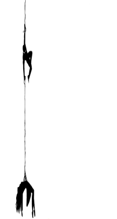
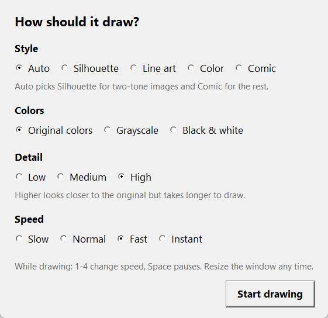
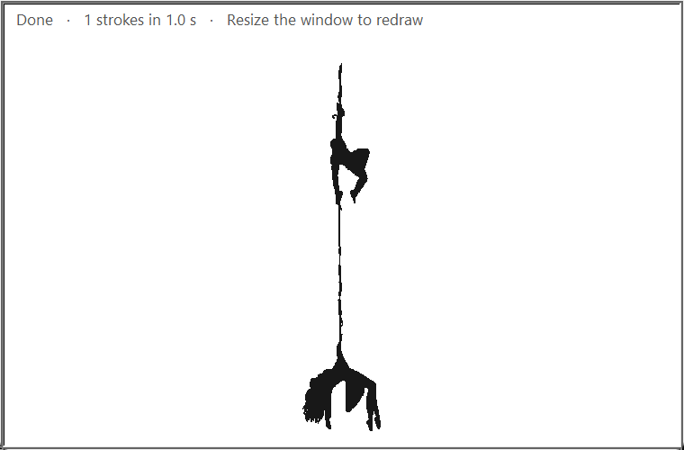

# Turtle Image Sketcher

**Turn any image into a live, hand-drawn animation: pencil sketch, silhouette, line art, flat color or comic style. OpenCV finds the shapes, and Python's turtle draws them.**

[](https://github.com/Umair-Habibx123/turtle-image-sketcher/actions/workflows/ci.yml)


**Status:** a small learning project, actively maintained (last updated November 2026). Tested on Windows 11 with Python 3.11. CI tests Python 3.10 and 3.12 on Windows and Ubuntu.
**License:** none yet. This project builds on [nourhan11atef/Spiderman_Recreate_image](https://github.com/nourhan11atef/Spiderman_Recreate_image), which has no license, so I've asked the original author to add one. Until then, ask before reusing this code.



<sub>The GIF is rendered by `tools/make_demo.py` from the same shapes the turtle draws. The real program draws in a turtle window.</sub>

## Quick start

```bash
pip install -r requirements.txt
cp .env.example .env        # Windows Command Prompt: copy .env.example .env
python main.py
```

A setup window lets you pick the **style**, **colors** (original, grayscale or black and white), **detail** and **speed**. Then a turtle window draws the bundled `spiderman.png`. While it draws:
- press **1 to 4** to change the speed
- press **Space** to pause
- resize or maximize the window, and the drawing redraws to fit

To use your own picture, set `IMAGE_SOURCE` in `.env` to a file path or an image URL:

```bash
IMAGE_SOURCE=my-photo.png
# or
IMAGE_SOURCE=https://example.com/images/silhouette.png
```

**Requirements:** Python 3.10 or newer. The turtle window needs Tk, which the python.org installers for Windows and macOS include. On Linux, install it with `sudo apt install python3-tk`. With Homebrew on macOS, use `brew install python-tk`.

 

## Styles, colors and detail

Pick these in the setup window, or set `MODE`, `PALETTE` and `DETAIL` in `.env`. The default style, `auto`, picks **silhouette** for two-tone images, **sketch** for pencil drawings and black-and-white photos, and **comic** for everything else. Drawings on a plain page are cropped to the subject first, so it fills the window.

| Mode | What it draws | Best for |
|---|---|---|
| `silhouette` | Solid filled shapes from one brightness cutoff, picked automatically | Silhouettes and logos, on light or dark backgrounds |
| `lineart` | The image's edges as pen lines, like a sketch | Outlines and drawings |
| `color` | The image reduced to a few flat colors, each region filled in its color | Posters, landscapes and photos |
| `comic` | Flat colors with line art drawn on top | Anime, cartoons and illustrations |
| `sketch` | A pencil scribble: the pen visits every dark pixel, always hopping to the nearest one next | Pencil drawings and black-and-white photos |

- **Colors:** `original` keeps the image's own colors, including tinted line art. `grayscale` draws in shades of gray, and `bw` in pure black and white.
- **Detail:** `low` (8 colors), `medium` (14) or `high` (24, the default). Higher detail looks closer to the original but draws more strokes. A detailed anime illustration in comic style at high detail is about 1,900 strokes, which takes about 30 seconds at **Fast**.

## How it works

1. **Load:** `image_loader.py` opens the file, or downloads the URL to a temporary file first. It checks the download really is an image.
2. **Resize:** the image is scaled to `TARGET_HEIGHT` pixels tall, keeping its proportions.
3. **Find strokes:** `sketch_modes.py` turns the image into strokes for the chosen mode:
   - **silhouette:** an [Otsu](https://en.wikipedia.org/wiki/Otsu%27s_method) threshold, with the image's border used to tell background from subject
   - **lineart:** a [Canny](https://en.wikipedia.org/wiki/Canny_edge_detector) edge detector after edge-preserving smoothing
   - **sketch:** an [adaptive threshold](https://docs.opencv.org/4.x/d7/d4d/tutorial_py_thresholding.html) keeps faint pencil marks, then a greedy nearest-neighbour path links them, using a grid so each step only checks nearby pixels
   - **color:** [k-means](https://en.wikipedia.org/wiki/K-means_clustering) color reduction in Lab color space, on top of a base layer in the most common color, with big regions painted first and details on top
4. **Draw:** the turtle walks each stroke point by point, filling shapes and tracing lines. The drawing is scaled to fill the window, and when the window changes size, everything drawn so far is redrawn instantly at the new size. The bundled image becomes 1 shape with about 2,300 points.

## What it's good at, and what it isn't

- **Good for:** the "watch it being drawn" effect on silhouettes, logos, illustrations and anime art. For detailed illustrations, pick **Fast** or **Instant**, or a lower detail.
- **Not for:** photo-realistic results. Color mode flattens soft gradients into a few colors, and line art only finds strong edges. For a pencil-style still image, try OpenCV's `cv2.pencilSketch` instead.
- **Imperfect fills:** traced outlines aren't always clean closed loops, so complex or overlapping shapes can fill slightly wrong.

## Configuration

Every setting lives in `.env`. Only `IMAGE_SOURCE` is required, and `.env.example` explains each one.

| Variable | Default | Effect |
|---|---|---|
| `IMAGE_SOURCE` | none, required | Local file path or image URL |
| `TARGET_HEIGHT` | `700` | Height in pixels the image is resized to |
| `SHOW_SETUP` | `true` | Show the setup window before drawing. `false` uses the settings below straight away |
| `MODE` | `auto` | `auto`, `silhouette`, `lineart`, `color`, `comic` or `sketch`. See [Styles, colors and detail](#styles-colors-and-detail) |
| `PALETTE` | `original` | `original`, `grayscale` or `bw` |
| `DETAIL` | `high` | `low`, `medium` or `high` |
| `COLORS` | `auto` | Exact number of colors for the color and comic styles, 2–32. `auto` follows `DETAIL` |
| `SPEED` | `normal` | `slow`, `normal`, `fast`, `instant`, or `custom` to use `UPDATE_EVERY` |
| `UPDATE_EVERY` | `3` | With `SPEED=custom`: points drawn between screen refreshes |
| `THRESHOLD` | `auto` | Silhouette style: brightness cutoff 0–255, or `auto` to pick it from the image |
| `MIN_CONTOUR_AREA` | `15` | Silhouette style: smallest shape kept. Raise it to ignore specks |
| `WINDOW_WIDTH` / `WINDOW_HEIGHT` | `auto` | Window size in pixels. `auto` opens at 85% of your screen |
| `DRAW_SCALE` | `0.95` | How much of the window the drawing fills, 0.1–1.0. It follows the window as you resize it |
| `PEN_SIZE` | `1` | Line thickness |
| `BACKGROUND_COLOR` / `PEN_COLOR` | `white` / `black` | Any turtle color name or hex code |
| `SAVE_OUTPUT_PATH` | empty | Save the finished drawing as a PostScript (`.eps`) file |
| `AUTO_CLOSE_AFTER_SECONDS` | `0` | Close the window this many seconds after finishing. `0` keeps it open. Above `0`, the setup window is skipped so unattended runs don't wait |

## Project structure

```
main.py             Entry point: load, then find shapes, then draw
config.py           Reads and checks the .env settings
image_loader.py     Turns a file path or URL into an OpenCV image
sketch_modes.py     Turns the image into strokes: silhouette, lineart, color, comic or sketch
original/           The original single-file script by nourhan11atef, kept unchanged
tools/make_demo.py  Renders docs/demo.gif without opening a window
tests/              Tests for the pipeline (python -m pytest)
```

## Development

```bash
pip install -r requirements-dev.txt
python -m ruff check .
python -m pytest
python tools/make_demo.py      # regenerate docs/demo.gif
```

## Credits

The idea and the original script come from [nourhan11atef](https://github.com/nourhan11atef) in [Spiderman_Recreate_image](https://github.com/nourhan11atef/Spiderman_Recreate_image). This version adds:
- settings in `.env`
- image URLs
- clear error messages
- saving the output
- a setup window for style, colors, detail and speed, plus live speed and pause controls
- line art, color and comic styles, chosen automatically, in original colors, grayscale or black and white
- support for dark backgrounds, and a drawing that resizes with the window
- a pencil sketch style, based on the approach in [Akashsshinde07/Image-Sketch-Drawing-in-Turtle](https://github.com/Akashsshinde07/Image-Sketch-Drawing-in-Turtle) and rewritten to run much faster on large images
- tests, CI and a reproducible demo

Maintained by [Umair Habib](https://github.com/Umair-Habibx123).
